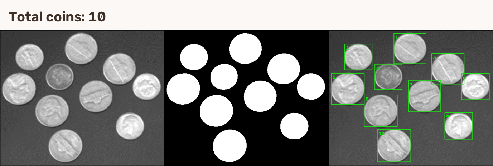

# 实验 01：硬币计数

二值化并用连通域统计硬币。

## 运行结果

**检测总数：10 枚硬币。**

[查看运行输出](Results/运行结果.txt) · [查看全部结果图](Results/)

## 如何运行

用 VS2022 打开 [01_CoinCounting.sln](01_CoinCounting.sln)，选 `Debug | x64` 或 `Release | x64`，按 F5。需要安装 C++ 桌面开发组件和 OpenCV 5.0.0；如果 OpenCV 安装路径不同，修改 `OpenCV_Config` 两张属性表里的 `OpenCVRoot`。
