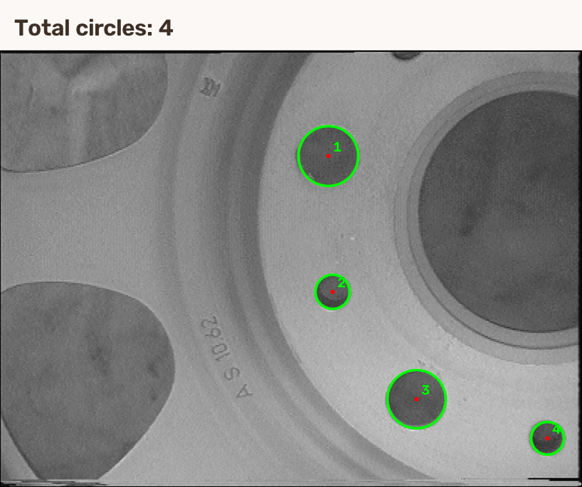

# 实验 03：小圆孔检测与计数

用霍夫变换检测并统计小圆孔。

## 运行结果

**检测总数：4 个小圆。**

[查看运行输出](Results/运行结果.txt) · [查看全部结果图](Results/)

## 如何运行

用 VS2022 打开 [03_CircleCounting.sln](03_CircleCounting.sln)，选 `Debug | x64` 或 `Release | x64`，按 F5。需要安装 C++ 桌面开发组件和 OpenCV 5.0.0；如果 OpenCV 安装路径不同，修改 `OpenCV_Config` 两张属性表里的 `OpenCVRoot`。
